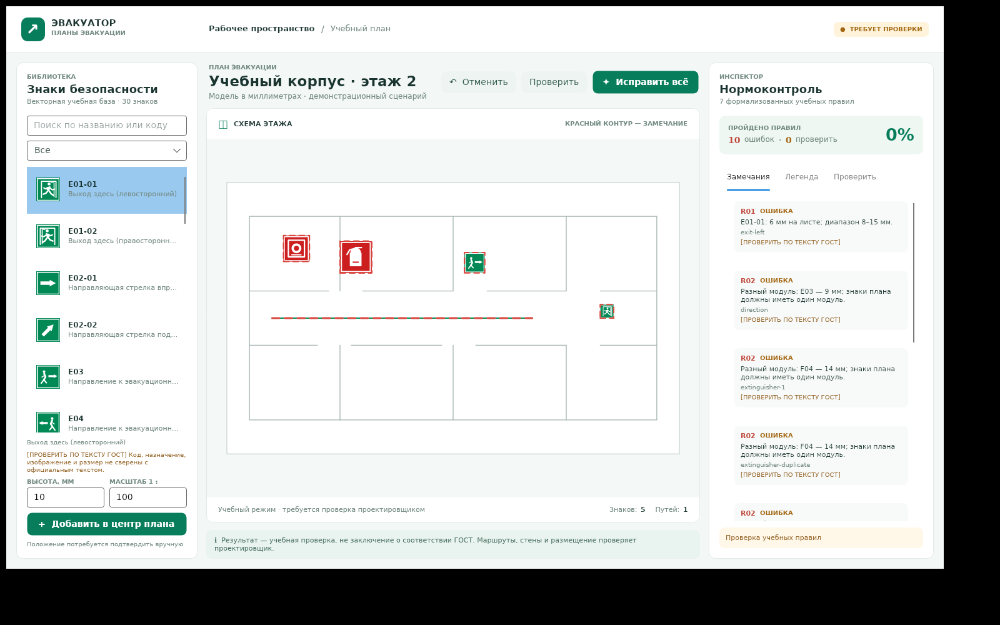

# Эвакуатор — учебный прототип нормоконтроля планов эвакуации

> **RESCUE-AND-VERIFY-01, 29.10.2026:** исходники сохранены в текущей Git-ветке и проверены на GitHub-hosted Linux с официальным .NET SDK/NuGet. Локальная Debian-песочница не может загрузить SDK. Реального nanoCAD-плагина, Windows host-проверки, DWG и PDF по-прежнему нет. Фактические SHA, результаты и первичные логи — в [индексе доказательств](docs/verification/EVIDENCE_INDEX.md); план передачи — [Windows handoff](docs/WINDOWS_HANDOFF.md).

> **Не использовать для реального проектирования, печати, согласования или эвакуации.** База, пиктограммы, размеры, телефоны и трактовки являются демонстрационными и не сверены с официальными текстами. `[ПРОВЕРИТЬ ПО ТЕКСТУ ГОСТ]` 100% в интерфейсе — только доля пройденных семи учебных правил, **не сертификат соответствия и не оценка безопасности**.
>
> **nanoCAD/MultiCAD не подключён.** Здесь есть исполняемое ядро, автономное окно Avalonia и симулятор CAD-документа, но нет чтения/записи DWG, регистрации команд, настоящих `McCustomBase`, smart grips, установщика или рабочего `.cuix`. Реальный SDK и хост в среде разработки отсутствовали; включение `NANOCAD_SDK` намеренно завершает компиляцию ошибкой. Не представляйте этот проект работающим плагином nanoCAD.



## Быстрый старт

Нужен [.NET SDK 10](https://github.com/dotnet/core), NuGet-доступ для Avalonia 11.3.18 и xUnit. `global.json` допускает feature-roll-forward в пределах SDK 10. На Linux для окна нужны графическая сессия и зависимости Avalonia/X11/Skia; CLI и тесты дисплея не требуют. Из корня репозитория:

```sh
dotnet restore Evakuator.sln
dotnet build Evakuator.sln -c Release --no-restore
dotnet test Evakuator.sln -c Release --no-build --no-restore
dotnet run --project src/Evakuator.CliDemo -c Release --no-build --no-restore
dotnet run --project src/Evakuator.UI -c Release --no-build --no-restore
```

Без дисплея доступна проверка загрузки модели и ViewModel (это **не** тест реального окна):

```sh
dotnet run --project src/Evakuator.UI -c Release --no-build --no-restore -- --self-check
```

Для другой базы/плана у UI есть `--norms путь.json --plan путь.json`. UI работает с отдельной in-memory копией плана: вставка знака в центр, исправление и отмена не записывают DWG/исходный JSON. Окно ищет базу и sample в рабочей папке или рядом с приложением. Автоподгрузка отслеживает **основной файл базы**; невалидное изменение не заменяет последнюю корректную версию. Для реального использования сделайте резервную копию базы и проверьте её экспертом.

## Демо и результаты

`samples/bad_bazaar_plan.json`: 10 ошибок в семи категориях R01–R07. В текущем демо после 12 изменений — 0 ошибок учебных правил, 100% учебного индекса, **2 предупреждения и 8 пунктов ручной проверки**. Даже после обработки не доказаны положение маркера, направление и проходимость пути, расположение знаков, текст или нормы. `samples/reference_clean_plan.json` соответствует этому учебному результату, но сохраняет предупреждения; повторный heal его не меняет.

В `artifacts/` создаются:

| Файл | Содержание |
|---|---|
| `demo_before.svg`, `demo_after.svg` | векторные схемы до/после, с красным выделением ошибок |
| `validation_before.json`, `validation_after.json` | список ошибок, предупреждений и учебный индекс |
| `legend_table.svg` | легенда по фактическому составу |
| `healing_diff.json` | изменения «было → стало» и действия специалиста |
| `demo_after_plan.json` | новая JSON-модель, исходный файл не перезаписывается |

Предпросмотр без запуска: [до](docs/demo/demo_before.svg), [после](docs/demo/demo_after.svg), [легенда](docs/demo/legend_table.svg), [окно после](docs/demo/ui-after.png), [учебный каталог 30 знаков](docs/verification/sign_catalog.svg). Каталог создан C#-генератором геометрии и не является официальным эталоном. Сгенерированная директория `artifacts/` игнорируется Git; SVG в `docs/demo/` — снимок демонстрации.

```sh
dotnet run --project src/Evakuator.CliDemo -c Release -- \
  --norms norms/gost_12_4_026_2015.json \
  --amendment norms/sample_custom_amendment.json \
  --plan samples/bad_bazaar_plan.json --output-dir artifacts
```

`--help` показывает опции. Коды выхода: `0` — ошибок учебных правил после обработки нет (предупреждения возможны); `2` — остались ошибки; `1` — не удалось прочитать/обработать вход. Файлы пишутся по одному с временным именем и заменой; **весь набор не является единой файловой транзакцией**.

Учебный SVG-каталог можно воспроизвести отдельным инструментом (он не входит в solution):

```sh
dotnet restore tools/Evakuator.SignCatalog/Evakuator.SignCatalog.csproj --source https://api.nuget.org/v3/index.json
dotnet run --project tools/Evakuator.SignCatalog -c Release --no-restore -- \
  norms/gost_12_4_026_2015.json artifacts/sign_catalog.svg
```

Проверки CLI/каталога, логи и TRX воспроизводятся через `bash tools/verify-dotnet-linux.sh SOURCE_DIRECTORY EVIDENCE_DIRECTORY` при наличии официальных SDK и NuGet; выходной каталог должен быть новым или пустым и находиться отдельно от исходников.

## Слои и ограничения

| Модуль | Назначение |
|---|---|
| `Evakuator.Domain` | неизменяемые сущности, система координат Y вверх, значения и JSON-модель, без внешних зависимостей |
| `Evakuator.Norms` | JSON-репозиторий, строгая проверка, атомарная публикация последнего корректного снимка и watcher |
| `Evakuator.Geometry` | параметрическая векторная геометрия, стрелки, легенда, рамочная компоновка и безопасный XML/SVG |
| `Evakuator.Validation` | 7 независимых правил, отчёты и консервативный неизменяемый healer |
| `Evakuator.CadAdapter` | контракты, симулятор snapshot/revision/undo и хост-независимые команды; SDK заглушками не подменяется |
| `Evakuator.UI` | отдельное окно Avalonia: каталог, поиск, векторный план, замечания, легенда, heal/undo |
| `Evakuator.CliDemo` | сквозной сценарий и воспроизводимые SVG/JSON |
| `Evakuator.Tests` | xUnit, включая граничные случаи, транзакции, watcher, UI ViewModel и сквозное демо |

Расстояния модели заданы в мм, `HeightMmOnPaper = ModelHeight / DrawingScale`; размер прямоугольного носителя 2:1. Учебные пороги 8–15 мм и модуль 10 мм **не подтверждены**. Рамки 600×400/400×300 мм — значения из задания, не следует называть их точными форматами ISO A2/A3. Фоновые линии — иллюстрация: стены/двери/препятствия, видимость, доступность и соответствие действующим требованиям не анализируются. Автосдвиг и привязка к **знаку**, а не к подтверждённой двери, маркируются для ручной проверки. Бесконечное автоматическое «исправление любого плана» не обещается: неоднозначности остаются ошибками и ручными задачами.

## Изменение базы

`norms/gost_12_4_026_2015.json` — 30 **схематичных**, а не официальных знаков E/F/EC/P/W. Схема рядом; проверка выполняется и при загрузке, включая требуемые поля, дубли JSON и кодов, цвета, границы и межполевые ограничения. Точность SVG и шрифта зависит от рендерера. `sample_custom_amendment.json` показывает добавление E99 и дуги; `--amendment` может заменить полный знак, настройки или шаблон. Примитивы: `Rect` (после поворота — полигон), `Circle`, `Polygon`, `Polyline`, `Arc`, `Text`; координаты нормализованы к носителю. Подробности и правила проверки: [ADR-002](docs/ADR-002-Parametric-Sign-Vector-DSL.md).

## Документация

- [ADR-001: архитектура и изоляция SDK](docs/ADR-001-Clean-Architecture-and-SDK-Isolation.md)
- [ADR-002: векторный DSL](docs/ADR-002-Parametric-Sign-Vector-DSL.md)
- [ADR-003: правила и лечение](docs/ADR-003-Norm-Control-Rule-Engine.md)
- [Чек-лист официальной сверки](docs/GOST_VERIFICATION_CHECKLIST.md)
- [Архитектура и границы](docs/ARCHITECTURE.md)
- [Матрица переносимости Linux/Windows](docs/PORTABILITY_MATRIX.md)
- [Windows handoff](docs/WINDOWS_HANDOFF.md) и [host-runbook H01–H25](docs/WINDOWS_HOST_TEST_RUNBOOK.md)
- [Реальные шаги подключения nanoCAD SDK](docs/NANOCAD_SDK_INTEGRATION_GUIDE.md)
- [Индекс первичных доказательств](docs/verification/EVIDENCE_INDEX.md)
- [Инженерный отчёт](CURATOR_REPORT.md)
